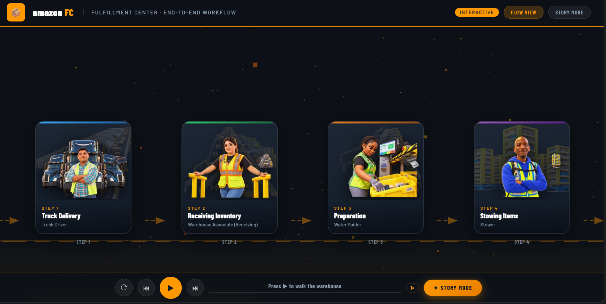

# Extern Project 308: Amazon Fulfillment Center

**Owner:** Steve0a | **Started:** March 2026 | **Status:** Active

> Extern Project 308 work on Amazon Fulfillment Center (FC) operations and worker feedback, plus the reusable AI workflow I use to build each deliverable.

**Live site:** [fulfillmentcenterjourney.com](https://fulfillmentcenterjourney.com)

[](https://fulfillmentcenterjourney.com)

*Flow View of the live site: each step card shows the role in the FC workflow. Click the image to open the site.*

---

## Current Progress (October 3, 2026)

| Item | Status |
|---|---|
| Interactive Amazon FC Fulfillment Journey site (`site/index.html`) | Done |
| Deployed on Cloudflare Workers (`amazonfcjourney.steveoamo960.workers.dev`) | Done |
| Custom domain `fulfillmentcenterjourney.com` (+ `www.`) connected | Done |
| Worker-feedback analysis: 124 Glassdoor reviews + 8 YouTube worker videos | In progress |
| Themes: Pay & Benefits, Schedule & Physical Workload (priority), Management & Growth | In progress |
| Project 4: root-cause (5 Whys) and recommendation pitch | In progress |

### The live site
- **Flow View:** each FC step as a card with the role, its tasks, tools, who it works with, and a RACI breakdown
- **Story Mode:** guided walkthrough with play/pause, previous/next, and speed controls
- **3D warehouse scene:** built with Three.js
- **Roles:** Truck Driver → Receiving → Water Spider → Stower → Picker → Packer → SLAM → Shipping → Delivery Driver, with Problem Solver across the flow

Run locally: open `site/index.html` in any browser. No build step needed.

---

## What This Is

Every time I start a new project (dashboard, BPMN diagram, website, presentation, PDF guide), I follow the same folder structure and the same chain of prompts. Only the subject changes.

Think of it like a recipe book. The recipe stays the same. You just swap the ingredients.

---

## The 5-Agent Pipeline

| # | Agent | Job | Tool |
|---|-------|-----|------|
| 1 | **Context Collector** | Research and gather business info | Perplexity |
| 2 | **Prompt Architect** | Build structured JSON master prompt | ChatGPT |
| 3 | **Builder** | Build the actual output (HTML, dashboard, etc.) | Claude |
| 4 | **Refiner** | Fix and polish until it looks right | Claude / Comet |
| 5 | **SOP Writer** | Write the guide, README, article, Gumroad PDF | Claude / Comet |

---

## Folder Structure

```
extern-project-308-amazon-fc/
├── 00_meta/           # What this system is
├── 01_memory/         # Who I am, preferences, project history
├── 02_skills/         # How-to guides for specific techniques
├── 03_prompts/        # All reusable and project-specific prompts
├── 04_sop_outputs/    # Final published content
├── 05_chain_commands/ # Step-by-step pipeline instructions
├── 06_projects/       # One folder per project
├── 07_templates_master/ # Master templates for new projects
├── site/              # Live Amazon FC Fulfillment Journey site (index.html)
└── assets/            # Screenshots and images
```

---

## Case Study #1 — Amazon Fulfillment Center BPMN

**What I built:** An interactive HTML dashboard showing the full Amazon FC end-to-end workflow with BPMN-style design, RACI cards, swimlanes, color-coded roles, zoom/pan, and clickable side panels.

**Tools used:** Perplexity (context) → ChatGPT (JSON prompt) → Claude (build + refine)

**Folder:** `06_projects/` (project notes) and `site/` (live build)

**Live:** https://fulfillmentcenterjourney.com

---

## Golden Rule

> No agent starts from scratch. Every agent receives a file as input. Every agent saves a file as output. Nothing lives only in your head.

---

## How to Start a New Project

1. Copy `07_templates_master/NEW_PROJECT_KICKOFF.md`
2. Fill it in (5 minutes)
3. Follow `05_chain_commands/CHAIN_full_pipeline.md`
4. Done — your output + SOP are both saved

---

*Educational project for Extern Project 308. Not affiliated with or endorsed by Amazon.*

*Built by Steve0a | Park University Data Analytics*
